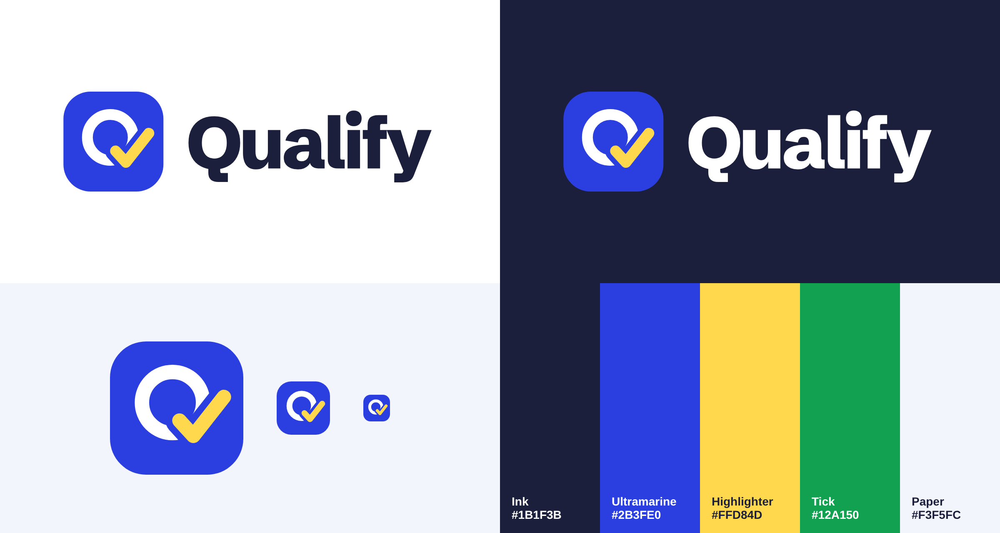

# Qualify — Online Course Marketplace

A full-featured online teaching platform built with **Next.js 15 (App Router)**, **Bootstrap 5**, **Prisma ORM** and **PostgreSQL**.

Students browse, buy and learn; instructors build and sell courses and get paid through **Stripe Connect**; admins moderate the marketplace.



Brand assets live in `public/brand/`: `qualify-logo.svg` / `.png` (light backgrounds), `qualify-logo-white.svg` / `.png` (dark backgrounds), `qualify-mark.svg` and `qualify-mark-512.png` (app icon / favicon). The wordmark is outlined, so it renders identically without the font installed.

---

## ✨ Features

**Students**
- Course catalog with search, category / level / price / rating filters, sorting and pagination
- Rich course landing pages: curriculum, free preview lectures, outcomes, requirements, instructor bio, rating breakdown, reviews, "students also bought"
- Cart that works before login (saved in the browser, merged into the account on sign-in), slide-out mini cart,
  save for later, "learners also added" recommendations, sale + coupon savings breakdown
- Stripe Checkout payments in US dollars, receipts and purchase history
- Free-course instant enrollment
- Wishlist
- Full-screen course player: YouTube / Vimeo / MP4 support, curriculum sidebar, progress tracking, auto-complete & autoplay next, "continue where you left off"
- Lecture **Q&A** (instructor answers highlighted), **timestamped private notes** (click to seek), course reviews
- Auto-issued **certificates** at 100% with a public verification page (print / save as PDF)
- In-app notifications, profile & password management, "Become an instructor"

**Instructors**
- Dashboard with earnings chart (last 6 months), students, ratings, unanswered questions
- **Earnings & payouts**: per-sale ledger (price, Qualify fee, your earning, payout status), per-course totals, Stripe Connect onboarding, one-click withdraw, Stripe Express dashboard link
- Course studio: details, thumbnail & promo video, outcomes, requirements, tags, language, level
- Curriculum builder: sections & lectures, reorder, free previews, downloadable resources, auto video-duration detection
- Pricing with sale prices, course-specific coupons
- Publishing checklist → submit for admin review
- Students list with progress, reviews feed

**Admins**
- Platform stats + revenue chart, review queue (approve / reject with reason)
- **Payouts**: gross sales, platform fees, what each instructor is owed, send via Stripe or mark paid manually, refunds
- **Course review console** (`/admin/courses/:id`): watch every lecture of any course (drafts and pending too), automatic
  quality checks, sales/refund stats, reports and history — then approve, request changes, take down, restore or feature
- **Instructor & user moderation** (`/admin/users/:id`): risk signals (refund rate, open reports, rating, takedowns),
  warn, pause (optionally holding payouts), ban, reactivate, change role
- **Reports queue**: students report courses, reviews, questions and answers; reports are grouped per item with
  one-click actions (take down, hide review, remove post, warn, pause)
- **Activity log**: every admin action is recorded with who, what and why
- Manage courses (status, featured), users (roles, delete), categories (icon & color), site-wide coupons

**Tech**
- Stripe Checkout + Stripe Connect (Express) with signed webhooks, idempotent fulfilment and transfers
- REST API (`app/api/**`) with JWT cookie auth (httpOnly), role-based access control, and route middleware
- Prisma Rust-free client with the `pg` driver adapter (deploys to Vercel, Docker or any VPS)
- Responsive, custom-themed Bootstrap UI with Bootstrap Icons and Chart.js

---

## 🐳 Run with Docker (port 5000)

The quickest way to run everything — the app, PostgreSQL, migrations and demo data:

```bash
docker compose up --build -d
```

Open **http://localhost:5000** (API docs at http://localhost:5000/docs). The first start takes a few minutes while
the image builds.

What happens:

| Service | What it does |
|---|---|
| `db` | PostgreSQL 16. Data lives in the `qualify-data` volume, so it survives restarts. |
| `migrate` | Runs once: `prisma migrate deploy`, then loads demo data **only if the database is empty** (restarts never wipe your data). |
| `app` | The Next.js server on port **5000**, started after migrations succeed. |

Configure it with a `.env` file next to `docker-compose.yml` (all optional):

```bash
JWT_SECRET="a-long-random-string"          # change this for anything public
APP_URL="http://localhost:5000"            # public URL, used for Stripe redirects
STRIPE_SECRET_KEY="sk_test_..."            # empty = demo checkout
STRIPE_WEBHOOK_SECRET="whsec_..."
PLATFORM_FEE_PERCENT="30"
SEED_DEMO_DATA="true"                       # "false" to start with an empty site
POSTGRES_PASSWORD="postgres"
DB_PORT="5432"                              # host port for PostgreSQL (change if 5432 is taken)
```

Everyday commands:

```bash
docker compose logs -f app       # follow app logs   (npm run docker:logs)
docker compose down              # stop, keep data   (npm run docker:down)
docker compose down -v           # stop and delete the database
docker compose up --build -d     # rebuild after code changes (npm run docker:up)
docker compose run --rm migrate  # re-run migrations
```

For Stripe webhooks in Docker: `stripe listen --forward-to localhost:5000/api/stripe/webhook`.

## 🚀 Getting started (without Docker)

**Requirements:** Node.js 18.18+ (20 or 22 recommended) and PostgreSQL 13+.

```bash
# 1. Install dependencies
npm install

# 2. Configure environment
cp .env.example .env
#   → edit DATABASE_URL and JWT_SECRET

# 3. (Optional) start Postgres with Docker
docker compose up -d

# 4. Create the database tables
npx prisma migrate deploy        # or: npx prisma migrate dev

# 5. Load demo data
npm run db:seed        # ~160 users, 34 courses, a year of orders, reviews, Q&A and moderation cases

# 6. Run the app
npm run dev                      # http://localhost:3000
```

Production: `npm run build && npm start`

### Demo accounts (password: `password123`)

| Role       | Email                     |
|------------|---------------------------|
| Admin      | admin@qualify.dev (also moderator@qualify.dev) |
| Instructor | instructor@qualify.dev   |
| Student    | student@qualify.dev      |
| Paused instructor (moderation demo) | daniel@qualify.dev |
| Reported instructor (moderation demo) | rocky@qualify.dev |

Coupons: `WELCOME20` (20% off everything), `LEARN50` (50%, 100 uses), `REACT30` (React course only).

---

## 📁 Project structure

```
app/
  api/                 REST API route handlers (see below)
  courses/             catalog (/courses) and course landing page (/courses/[slug])
  learn/[slug]/        course player
  cart/                cart + checkout
  dashboard/           student dashboard (learning, certificates, purchases)
  instructor/          instructor dashboard + course studio
  admin/               admin panel
  certificates/[id]/   public certificate verification
  instructors/[id]/    public instructor profile
  login, register, profile, wishlist, teach
components/            UI components (Navbar, CourseCard, player panels, charts…)
lib/                   prisma client, auth/JWT, API helpers, queries, utils
prisma/                schema, migrations, seed
middleware.js          page protection by role
```

---

## 📖 Interactive API docs (Swagger)

- **Swagger UI:** [`/docs`](http://localhost:3000/docs) — every endpoint with request/response schemas and **Try it out**.
  Run `POST /api/auth/login` from the page first; the session cookie is reused for the other calls.
- **OpenAPI 3.1 spec:** [`/api/openapi.json`](http://localhost:3000/api/openapi.json) — import into Postman, Insomnia
  or a client generator. The spec lives in `lib/openapi.js`.

## 🔌 API reference

All endpoints return JSON. Auth uses an httpOnly `lh_token` cookie set by login/register.

| Method | Endpoint | Access | Description |
|---|---|---|---|
| POST | `/api/auth/register` | public | Create account `{name,email,password,role?}` |
| POST | `/api/auth/login` | public | Log in `{email,password}` |
| POST | `/api/auth/logout` | any | Log out |
| GET | `/api/auth/me` | any | Current user + cart/notification counts |
| GET/PUT | `/api/profile` | user | Read / update profile, change password |
| POST | `/api/profile/become-instructor` | user | Upgrade to instructor |
| GET | `/api/categories` | public | Categories with course counts |
| POST | `/api/categories` | admin | Create category |
| PUT/DELETE | `/api/categories/:id` | admin | Update / delete category |
| GET | `/api/courses` | public | Search: `q, category, level, price, rating, sort, page, limit` |
| POST | `/api/courses` | instructor | Create course |
| GET/PUT/DELETE | `/api/courses/:id` | owner | Read (full) / update / delete course |
| POST | `/api/courses/:id/publish` | owner | `{action:'submit'|'unpublish'}` |
| POST | `/api/courses/:id/sections` | owner | Add section |
| PUT/DELETE | `/api/sections/:id` | owner | Rename / reorder / delete section |
| POST | `/api/sections/:id/lectures` | owner | Add lecture |
| PUT/DELETE | `/api/lectures/:id` | owner | Update / reorder / delete lecture |
| GET/POST/DELETE | `/api/courses/:id/reviews` | enrolled | List / create-or-update / delete my review |
| POST | `/api/courses/:id/enroll` | user | Enroll in a free course |
| GET | `/api/learn/:slug` | enrolled/owner | Player data with progress |
| POST/PUT | `/api/lectures/:id/progress` | enrolled | Toggle complete / save last position |
| GET/POST | `/api/lectures/:id/questions` | enrolled | Q&A (`?scope=lecture|course`) |
| POST | `/api/questions/:id/answers` | enrolled | Answer a question |
| GET/POST | `/api/lectures/:id/notes` | enrolled | My timestamped notes |
| PUT/DELETE | `/api/notes/:id` | owner | Edit / delete note |
| GET/POST | `/api/wishlist` | user | List / toggle `{courseId}` |
| GET/POST/DELETE | `/api/cart` | user | Cart (`DELETE ?courseId=`) |
| POST | `/api/coupons/validate` | user | Apply coupon to cart `{code}` |
| POST | `/api/checkout` | user | Create order + Stripe Checkout Session → `{url}` `{couponCode?}` |
| GET | `/api/checkout/verify` | user | Confirm payment (`?session_id=` or `?order=`) |
| POST | `/api/stripe/webhook` | Stripe | Payment, refund and Connect account events |
| PATCH | `/api/cart` | user | Save for later / move to cart `{courseId, savedForLater}` |
| POST | `/api/cart/merge` | user | Merge a guest cart after login `{courseIds}` |
| GET | `/api/cart/preview` | public | Price a guest cart `?ids=a,b` |
| GET | `/api/instructor/earnings` | instructor | Earnings ledger, balances, Stripe status |
| POST | `/api/instructor/earnings/connect` | instructor | Start Stripe Connect onboarding → `{url}` |
| POST | `/api/instructor/earnings/dashboard` | instructor | Stripe Express dashboard link → `{url}` |
| POST | `/api/instructor/earnings/withdraw` | instructor | Send pending earnings now |
| POST | `/api/reports` | user | Report `{targetType: COURSE|REVIEW|QUESTION|ANSWER|USER, targetId, reason, details?}` |
| GET | `/api/admin/reports` | admin | Reports queue grouped by item (`?status=OPEN|RESOLVED|DISMISSED`) |
| PATCH | `/api/admin/reports/:id` | admin | Resolve/dismiss `{status, action?, resolution?}` |
| GET/POST | `/api/admin/courses/:id` | admin | Full course review data / `{action: approve|reject|suspend|restore|unpublish|feature|unfeature, reason}` |
| GET/POST | `/api/admin/users/:id` | admin | User detail + risk signals / `{action: warn|suspend|ban|reactivate|hold-payouts|release-payouts|role, reason, holdPayouts?, role?}` |
| PATCH | `/api/admin/reviews/:id` | admin | Hide or restore a review `{hidden, reason}` |
| DELETE | `/api/admin/discussions/:id` | admin | Remove a question/answer `?type=QUESTION|ANSWER&reason=` |
| GET | `/api/admin/activity` | admin | Audit log (`?targetType=&q=&page=`) |
| GET/POST | `/api/admin/payouts` | admin | Payout overview; `{action:'release'|'mark-paid', instructorId?}` |
| POST | `/api/admin/orders/:id/refund` | admin | Refund order, reverse earnings |
| GET | `/api/enrollments` | user | My learning |
| GET | `/api/orders` | user | Purchase history |
| GET | `/api/certificates` | user | My certificates |
| GET | `/api/certificates/:id` | public | Verify certificate (id or serial) |
| GET/PATCH | `/api/notifications` | user | List / mark read |
| GET | `/api/instructor/stats` | instructor | Dashboard analytics |
| GET | `/api/instructor/students` | instructor | Enrolled students |
| GET/POST | `/api/coupons` | instructor/admin | List / create coupons |
| PATCH/DELETE | `/api/coupons/:id` | owner/admin | Toggle / delete coupon |
| GET | `/api/admin/stats` | admin | Platform stats |
| GET/PATCH/DELETE | `/api/admin/users` | admin | Users, change role, delete |
| GET/PATCH | `/api/admin/courses` | admin | Moderate courses, feature |

---

## 🛡️ Moderation

| Status | What happens |
|---|---|
| **Paused instructor** (`SUSPENDED`) | Can log in and learn, but can't create/edit courses, coupons or payouts. Their courses leave the catalog and every cart; existing students keep access. Payouts can be held. |
| **Banned** (`BANNED`) | Signed out everywhere and can't log in. Courses come off sale, payouts are held. |
| **Course taken down** (`SUSPENDED` course) | Removed from catalog and carts; existing students keep access; only an admin can restore it. |
| **Hidden review** | Not shown publicly and excluded from the course rating. |

Every action requires a reason, notifies the affected user, and is written to the `AdminAction` audit log.

## 💳 Payments & instructor payouts (Stripe)

**How the money flows**

1. A student checks out → `POST /api/checkout` prices the cart (sale prices + coupon) and creates a `PENDING` order.
   Each line records **Qualify's commission** (`PLATFORM_FEE_PERCENT`, default 30%) and the **instructor's earning** (the rest).
2. The student pays on **Stripe Checkout** (cards, UPI, wallets — whatever you enable in Stripe).
3. Stripe calls `POST /api/stripe/webhook` → the order is marked `PAID`, the student is enrolled, and each instructor's
   share is **transferred to their Stripe Connect account** (`transfer_group` = order id). The success page also confirms
   the payment, so it works even before your webhook is set up.
4. Instructors who haven't connected Stripe yet keep their earnings as **Pending**; they're sent automatically the moment
   onboarding finishes (`account.updated` webhook), or an admin can send/mark them paid from **Admin → Payouts**.
5. Refunds (Admin → Payouts → Refund, or a refund made in the Stripe Dashboard) refund the student, reverse the
   instructor transfer, remove course access and mark the earning as reversed.

**Setup (test mode)**

```bash
# 1. Keys from https://dashboard.stripe.com/test/apikeys → .env
STRIPE_SECRET_KEY="sk_test_..."
# 2. Enable Connect: https://dashboard.stripe.com/test/connect/accounts/overview  (choose "Express" accounts)
# 3. Forward webhooks locally with the Stripe CLI and copy the whsec_... secret into STRIPE_WEBHOOK_SECRET
stripe listen --forward-to localhost:3000/api/stripe/webhook --forward-connect-to localhost:3000/api/stripe/webhook
```

Test card: `4242 4242 4242 4242`, any future date, any CVC.

> **Use the secret key.** `STRIPE_SECRET_KEY` must start with `sk_test_` (or `sk_live_`). The publishable key (`pk_…`)
> can't create payments — if you paste it by mistake, checkout tells you exactly that instead of failing silently.
> Qualify uses Stripe-hosted Checkout, so no publishable key is needed anywhere.
In production, add a webhook endpoint for `https://your-domain/api/stripe/webhook` with the events
`checkout.session.completed`, `checkout.session.async_payment_succeeded`, `checkout.session.async_payment_failed`,
`checkout.session.expired`, `charge.refunded`, and (from connected accounts) `account.updated`.

**Demo mode:** leave `STRIPE_SECRET_KEY` empty and checkout completes instantly without charging — handy for local development.
Earnings are still recorded, and admins can mark payouts as paid manually.

> **India note:** Stripe Connect for platforms registered in India is available on request, and cross-border payouts
> have restrictions. If Connect isn't enabled on your account, Qualify still works: payments are collected by Stripe,
> the earnings ledger tracks what each instructor is owed, and admins pay instructors by bank transfer/UPI and click
> **Mark paid**.

## 🎬 Video hosting

Lectures accept YouTube, Vimeo or direct video URLs (MP4/WebM). For private paid videos, upload to a
service like Mux, Cloudflare Stream, Bunny or S3 + CloudFront with signed URLs and paste the URL into the lecture.

## ⚙️ Configuration

| Variable | Description |
|---|---|
| `DATABASE_URL` | PostgreSQL connection string |
| `JWT_SECRET` | Secret for signing login tokens — use a long random value |
| `NEXT_PUBLIC_APP_URL` | Public site URL (used for Stripe redirects) |
| `STRIPE_SECRET_KEY` | Stripe **secret** key (`sk_test_…` / `sk_live_…`, never the `pk_` publishable key) — empty = demo checkout |
| `STRIPE_WEBHOOK_SECRET` | Signing secret of your webhook endpoint |
| `PLATFORM_FEE_PERCENT` | Qualify's commission per sale (default `30`) |
| `NEXT_PUBLIC_APP_NAME` | Platform name |
